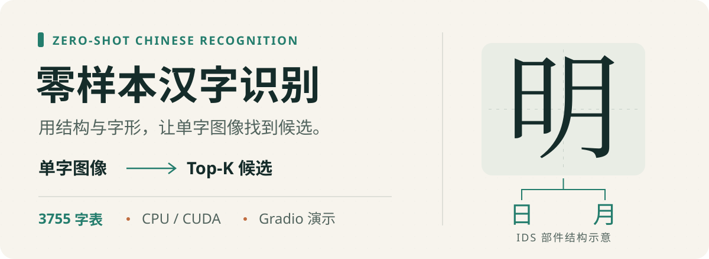
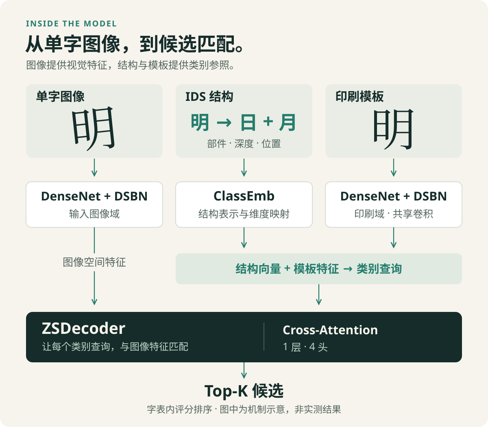

<p align="center">
  
</p>

# 零样本汉字识别

**[在线体验：零样本手写汉字识别](https://zero-shot-hanzi-hanaayane.awarecomet8.chatgpt.site)**

<sub>访问提示：在线演示需要科学上网环境才能访问。</sub>

无需安装，支持上传单字图片或手写输入，查看 Top-5 候选。在线版由本仓库随附权重转换为 ONNX，在浏览器内运行；输入图片无需上传服务器。首次使用需下载模型和运行组件，请等待加载完成。

上传一张**单个汉字**的图片，查看 Top-K 候选字及模型分数。

本项目将 `zero-shot-char-master` 的识别模型整理为 Gradio 交互演示：用 **IDS 部件结构 + 印刷体字形模板**构建类别查询，再通过 Transformer 跨注意力匹配输入图像。配套 HWDB 字表覆盖 **3755 个汉字**，推理自动选择 CUDA 或 CPU。

这是本科毕业设计的**推理演示仓库**。完整训练、数据集转换和实验分析脚本不包含在当前仓库中。

## 能做什么

- **单字识别**：上传图片，返回默认 Top-5 候选；可调整候选数量。
- **输入预处理**：灰度化、Otsu 二值化、按图像均值判断是否反色，再缩放至 32×32。
- **启动时预计算**：无梯度生成类别嵌入，并以每批 512 张模板提取视觉特征，供后续推理复用。
- **本机演示**：通过浏览器访问 Gradio；支持 CPU 与 NVIDIA CUDA，端口可配置。

适合居中、背景简单、主体清晰的单个汉字。当前没有文字检测、字符切分、整行或整页 OCR，也没有字表外字符拒识功能。候选分数是字表内的 softmax 输出，不能直接视为经过校准的识别正确概率。

## 工作原理

<p align="center">
  
</p>

1. **图像分支**：预处理后的单字图像经 DenseNet36 + DSBN，得到空间视觉特征。
2. **结构分支**：从预先生成的 `.npz` 读取部件 one-hot、分解深度和位置等信息，交给 `ClassEmb` 编码。
3. **模板分支**：加载宋体模板图像，通过共享卷积、独立域 BN 的主干提取模板特征，再进行空间加权汇聚。
4. **查询与匹配**：结构向量和模板特征拼接后，经线性层形成类别查询；一层、四头的 `ZSDecoder` 与图像空间特征做 cross-attention，输出各候选类别分数。

这里的“零样本”指：**未见类别没有参与训练的目标域手写样本**，但仍提供该字的结构描述与印刷模板；模型本身需要在可见类别上训练。当前演示加载固定的字符表、结构数据与权重，不会在上传图片时继续训练，也不会仅凭输入一个新字就自动扩展字库。

## 快速开始

### 1. 安装环境

```bash
git clone https://github.com/HanaAyane/zero-shot-chinese-recognition.git
cd zero-shot-chinese-recognition
python -m venv .venv
```

激活虚拟环境：Windows PowerShell 使用 `.venv\Scripts\Activate.ps1`；macOS / Linux 使用 `source .venv/bin/activate`。

安装依赖；需要 CUDA 时，按本机环境选择相匹配的 PyTorch 与 torchvision 版本：

```bash
python -m pip install torch torchvision gradio opencv-python numpy
```

已验证的本机环境为 Python 3.12、PyTorch 2.9.1、torchvision 0.24.1、Gradio 6.7.0、OpenCV 4.9.0、NumPy 1.26.4：完成 CPU / CUDA 单字推理检查，并通过 Gradio 页面上传汉字样例、提交识别与查看 Top-5 结果。该检查不是准确率评测，也不代表所有平台组合均已验证；仓库尚未提供依赖锁定文件。

### 2. 下载配套资源

Git 仓库已包含示例权重；字表、结构嵌入和模板以独立资源包分发，不写入 Git 历史。

**[下载 HWDB 配套资源包 · 2.28 MiB](https://github.com/HanaAyane/zero-shot-chinese-recognition/releases/download/resources-v1/zero-shot-hwdb-resources.zip)** · [资源版本与说明](https://github.com/HanaAyane/zero-shot-chinese-recognition/releases/tag/resources-v1) · [SHA-256 校验文件](https://github.com/HanaAyane/zero-shot-chinese-recognition/releases/download/resources-v1/zero-shot-hwdb-resources.zip.sha256)

将下载的 `zero-shot-hwdb-resources.zip` 放在项目根目录，然后解压：

```bash
python -m zipfile -e zero-shot-hwdb-resources.zip .
```

也可以用系统解压工具解压到项目根目录；压缩包已包含 `data/hwdb/` 层级，不需要手动建立目录或再次套一层 `data/hwdb/`。压缩包约 2.28 MiB，解压后约 237 MiB。

| 文件 | 用途 | 获取方式 |
|---|---|---|
| `data/hwdb/3755.txt` | 字符顺序；加载器取每行的第一个字符 | Release 资源包 |
| `data/hwdb/3755_parameter.npz` | IDS 结构数组，含 `onehot_array`、`depth_array`、`part_array` | Release 资源包 |
| `data/hwdb/simsun_hwdb.pkl` | 宋体模板图像张量，保存于 `char` 键中 | Release 资源包 |
| [14_90.17.pth](checkpoint/exp_handwriting_1500_template_dense36dsbn_decloss/14_90.17.pth) | DenseNet36 + DSBN 示例权重 | Git 仓库 |

字表、结构数组、模板的**类别数量与顺序必须一致**。模板 `.pkl` 保存的是图像，并非已经提取好的模板特征；特征在启动时计算。不要只替换其中一个文件或只修改类别数量参数。

### 3. 启动演示

在项目根目录运行以下单行命令，适用于 PowerShell、bash 和 zsh：

```bash
python demo_char.py --pretrained checkpoint/exp_handwriting_1500_template_dense36dsbn_decloss/14_90.17.pth --char_set data/hwdb/3755.txt --emb_path data/hwdb/3755_parameter.npz --template_path data/hwdb/simsun_hwdb.pkl
```

等待权重加载和模板预计算完成后，访问 [http://localhost:7860](http://localhost:7860)，上传单字图片即可推理。

默认使用 `densenet36_dsbn`、`emb_dim=266` 和 Top-5；可在命令末尾追加 `--top_k 10` 或 `--port 7861`。默认未启用公网分享；显式添加 `--share` 才会请求 Gradio 分享链接。

## 关键参数

| 参数 | 默认值 | 说明 |
|---|---|---|
| `--pretrained` | 必填 | `.pth` 权重，需匹配模型结构 |
| `--char_set` | 必填 | 字表路径 |
| `--emb_path` | 必填 | 配套结构嵌入 `.npz` 路径 |
| `--template_path` | 空字符串 | 参数解析不强制，但当前推理流程实际需要有效的 `.pkl` 路径 |
| `--backbone` | `densenet36_dsbn` | 与示例权重配套的视觉主干 |
| `--emb_dim` | `266` | 结构 one-hot 末维；线性映射输入为三组结构表示的拼接 |
| `--top_k` | `5` | 返回候选数，建议设为 1 至字表大小之间的整数 |
| `--port` | `7860` | Gradio 端口 |
| `--share` | 关闭 | 是否创建公网分享链接 |

`--seen_classes` 是模型训练分支中的可见类别控制参数；演示以 `sampling=False, training=False` 调用模型，因此它不是推理字库的开关。实际候选范围由加载的字符表、结构数组和模板共同决定。源码中的预处理固定缩放为 32×32，单独传入 `--loadSize` 不会改变这一流程。

## 从研究模型到演示系统

本项目的整理重点是让研究模型能够进行实际交互展示：

- **设备适配**：权重按 CPU / CUDA 加载，输入、结构数据和模板特征使用相同设备；演示入口使用自己的设备感知预计算函数。
- **推理准备**：启动时在 `torch.no_grad()` 下计算辅助特征，随后复用；避免每次上传都重新编码全部模板。
- **输入处理**：将用户上传的 RGB / RGBA 图像统一为二值单字输入，减少背景颜色与训练输入之间的差异。
- **界面兼容**：封装 Gradio 图片输入和候选输出，并对 `flagging_mode` / `allow_flagging` 两种参数形式提供兼容分支。
- **独立导出**：从完整研究工程提炼启动入口、模型及加载工具，使演示与训练数据处理流程分离。

### 毕业设计中的实验背景

在完整研究工程中，还开展了可见类别规模对照、CTW 数据适配、逐字错误与结构复杂度分析。HWDB 研究记录如下：

| 可见类 | 1000 个未见类图像上的 Top-1 | 权重来源 |
|---|---:|---|
| 500 | 76.52% | 毕业设计实验，`13_76.52.pth` |
| 1000 | 86.18% | 毕业设计实验，`17_86.18.pth` |
| 1500 | 90.17% | 原项目发布权重，作为参考；即当前演示随附的权重 |

前两组测试图像来自固定的 1000 个未见类别，预测候选空间为 3755 类。第三组沿用原项目划分，不能视为同条件重新训练的对照组；文件名中的 90.17% 也不代表用户上传图片的准确率。本仓库没有包含上述实验的训练脚本、完整划分、A/B 权重或基准重跑流程，这些历史结果与演示能力应分开理解。

## 目录导航

```text
.
├── demo_char.py           # Gradio 入口、预处理、设备适配与预计算
├── model/
│   ├── char_model.py      # 图像、结构、模板融合与推理
│   ├── class_embedding.py # IDS 结构表示
│   ├── transferLayer.py   # 结构维度映射
│   ├── densenetdsbn.py    # DenseNet 与域特定 BN
│   ├── transformer.py    # ZSDecoder / cross-attention
│   └── visual_backbone.py # 视觉主干选择
├── utils/
│   ├── class_emb_loader.py # 结构数组与模板图像加载
│   └── prepare_emb.py      # 原研究预计算工具；演示入口不调用它
├── checkpoint/           # 随附示例权重
├── assets/readme/        # 项目介绍图与流程图
└── data/hwdb/            # 从 Release 资源包解压，不写入 Git 历史
```

## 常见问题

**克隆后提示找不到文件？** 下载并在项目根目录解压上面的 Release 资源包，检查 `data/hwdb/` 下三个文件是否齐全。`.gitignore` 排除了这些辅助数据，Git 克隆不会自动下载它们；相对路径以启动命令所在目录为基准。

**能识别整页文档或任意新汉字吗？** 当前入口一次处理整张输入为一个字符，没有检测或切分。扩展字库需要相互匹配的新结构数据、模板和字符顺序，并重新评估效果。

**macOS 会自动用 MPS 吗？** 不会。当前设备判断只在 CUDA 与 CPU 间选择；macOS 在这份源码下走 CPU。源码中的 Gradio 兼容分支不等同于所有系统和版本都已通过完整验收。

**换一个 backbone 就能使用原权重吗？** 不能。当前发布路径围绕 `densenet36_dsbn`；其他分支的存在不代表它们能直接替换同一份权重与双域输入接口。

**为什么新权重或数据替换后需要重启？** 类别嵌入和模板视觉特征在启动时生成，运行期间不会自动热更新。

## 来源与许可

识别模型基于 `zero-shot-char-master`（Deep Embedding Network for Zero-shot Chinese Character Recognition）研究实现整理，保留了其结构嵌入、字形模板、DenseNet + DSBN 与 Transformer 匹配思路。这里的工作集中在毕业设计实验和演示应用适配，不将基础模型方法描述为本仓库原创。

本仓库包含 [MIT License](LICENSE)。模型权重、数据集与配套资源应同时保留各自原始来源及许可说明。
